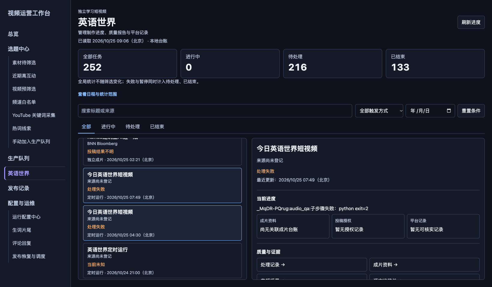
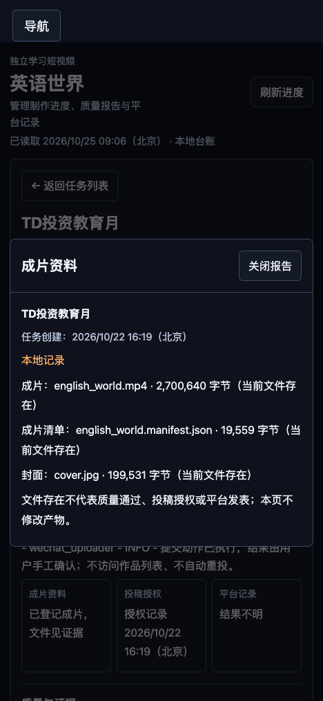

# 英语世界管理台开发与部署验收

日期：2026-10-25（Asia/Shanghai）。执行：Codex 本机会话；具体模型标识未由工具确认。

用户已批准交互设计稿，并明确要求“开发并部署”。本次将设计接入现有管理后台，采用既有主题、导航和本机会话边界。

## 已交付

- 入口：[管理后台 → 英语世界](http://127.0.0.1:9100/english-world)。桌面列表与详情分别滚动；手机切换列表/详情，返回保留查找条件和焦点。
- 读取人工任务、独立成片审核台账，以及在进入成片台账前停止的定时运行；按明确关联去重。
- 标题/来源搜索、任务状态、触发方式、北京时间创建日期可组合使用；每页 20 条，支持重置、空结果、分页和链接恢复。
- 处理记录、成片资料、音频质量、语言准确性、视觉检查、内容安全、平台回读依据共 7 类证据入口。
- 报告绑定当前文件指纹；缺失或不一致不能作为通过。平台受理、审核中、投稿结果不明与历史公开记录分别显示，刷新不访问创作者平台。
- 本次接口均为 GET，没有新增重试、审批、渲染或投稿接口；没有执行视频重试或发布。

## 验证证据

最终相关回归 **46 项通过**，覆盖新增服务/API、实际 Chromium 桌面与手机交互、现有工作台、主列表筛选及控制面访问边界。严格 UI 静态检查 **0 错误、0 警告**。桌面 1366×768 的三种既有主题，以及手机 390/320 宽度由隔离浏览器用例覆盖。

隔离回执目录（外置测试存储，遵循原自动清理策略）：

- `video-pytest-lnco7k93`：最终 46 项，退出码 0。
- `video-pytest-8xffq5fd`：新增功能相关 13 项，退出码 0；原生部署使用此运行的源清单。
- 两者均位于 `/Volumes/EXT2T/AppDataOffload/ryusei/TestRuns/`，源清单 SHA256 相同：`4624370ac974930c8d7c4dd75aa378122e3860a05a934ae8ece18f527c0173df`。
- 静态检查原始回执：`/tmp/english-world-console-20261025/premium-audit-final.json`。

部署后的真实浏览器验收：桌面 CSS 1366×800，手机 CSS 390×844；任务切换、搜索与触发/日期组合筛选、空结果清空详情、重置、第二页、证据弹窗、Esc 关闭和手机返回焦点均实际操作通过；未观察到横向溢出或页面脚本错误。

线上 HTTP 回读中，7 类报告均返回 200 并绑定所选任务。抽查 TD投资教育月的音频、语言、视觉和安全报告，当前文件指纹一致，均按“身份一致 · 历史报告 PASS”展示；平台状态仍为 `UNCERTAIN`，没有把质量通过转换为发表成功。Kahua + 独立成片 + 2026-10-25 组合查询返回 1 条；第二页与第一页没有重复任务。

实际回读快照：`/tmp/english-world-console-20261025/live-readback.json`。当时可读窗口 **252 条**，进行中 0、待处理 216、已结束 133；后两类允许重叠。完整账本有人工任务 12、成片审核项 81、定时运行日志 365；运行日志超过 200 条窗口，因此页面明确显示范围上限，252 不代表全部历史。无近期执行证据的旧记录不作为实时进度。

## 原生部署回读

- 功能提交：`db0c949ad67a2d6978c30ef049acbe6a8970dd4e`，已由原生采用流程合入当前 `main`。
- 部署 ID：`e19249e0d46b4d0b8d45e20264a97315`。
- 部署事务状态：`COMPLETE`，baseline / freeze / stop / backup / adopt / start / resume / restore / verify 九步全部完成。
- 事务目录：`/Users/ryusei/Library/Application Support/VideoProcessing/deployments/english-world-console-20261025-a/`。停止阶段中断后先核对进程身份并正常退出，再恢复同一原生事务；没有手工改写事务日志。
- 维护已恢复 `RUNNING`，原有调度恢复；既有搜索阶段配置、预算与发布保护由原生 final_status 复核通过。
- 新 UI 进程 PID 1500，出生标识 `1792890232.765063`；加载来源与当前工作区摘要一致：`9d0ecd9c3ba462ed2c396f7195ccc312dd8098eb8d743948efa31bb86d11e825`。
- 页面显示的制作时刻为 02:00、04:30、10:00、14:00、16:00、21:00（北京）。安装时刻与配置一致；页面没有把安装一致当作每次调度执行成功。
- 保留了工作区原有未提交内容；功能提交未夹带其他工作的改动。

## 扩展检查的边界

较早的扩展套件 `video-pytest-09xuu76v` 为 **138 通过、28 失败、6 个清理阶段错误**，不是全绿。其源清单早于最终回归：

- 其中导航入口数 5→6 的断言已随新增入口更新，最终 46 项运行包含该用例并通过。
- 其余失败集中在商品设置旧商品链测试数据、旧工作台“复核放行”弹窗及失败提示交互；6 个错误发生于相关用例清理阶段。本次没有修改这些业务行为，也没有将其全部归因为已确认的历史问题。
- 既有基线记录 `/tmp/dashboard-filter-fix-20261025/verification.md` 已独立复现商品链预览与旧复核弹窗的部分失败；本次没有重新完成其余失败的全量归因。

本次新增功能及相邻回归没有剩余已知阻断项；上述扩展套件问题保留在本记录，不能据此宣称整个项目测试通过。历史任务缺失的进度/平台证据继续显示未知，本次没有补造或触发回查。
