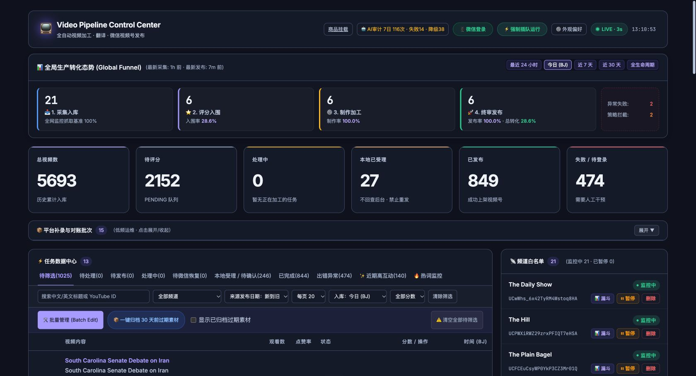
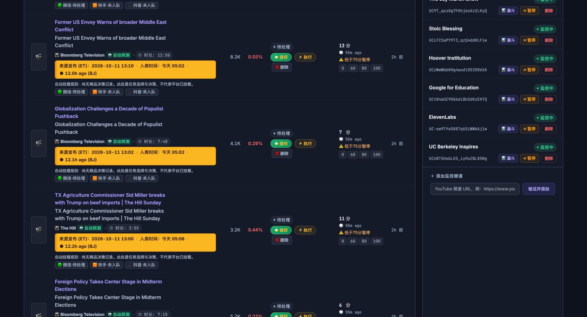
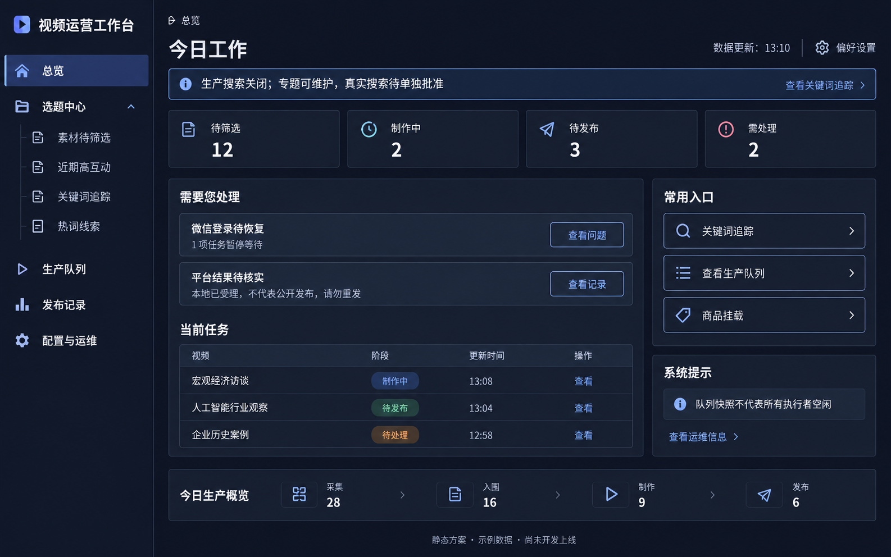

# 首页与关键词入口审查

审查：Codex；2026-10-12，北京时间。范围：用户正在使用的生产首页首屏、当前视频列表与频道侧栏、候选入口可用性。目标：解释入口缺失，提出首页导航和信息层级的推荐改版。

## 1. 当前结论

生产入口缺失是版本未采用：首页 HTTP 200，候选路径 HTTP 404；当前页面无关键词追踪链接。生产 main 仍为 `0419de50cfd806353256db607878bdd34a096878`，隔离候选分支为 `ae0e921`。旧热词线索不能代替候选工作台。未操作生产采用、配置、重启、专题创建或真实搜索。

首页已经具有列表分页、过滤、分平台状态、未受理／待核实提醒和频道启停入口，可保留这些有效能力。问题集中在功能层级、用户任务优先级和视觉表达；不能仅靠换色和加入口解决。

## 2. 本轮检查步骤与截图

1. 读取用户已打开的 Chrome 生产后台；未刷新或重新打开页面。首屏布局可用，但模块导航不完整、重点过多，健康度：需要改进。
2. 检查当时滚动位置的视频列表与频道侧栏。记录可读，但重复标题、时间警告块、密集小控件与频道配置争抢空间，健康度：需要改进。
3. 对已知候选路由执行只读 HTTP 核对。返回 404，健康度：入口不可用；原因是生产尚未采用。没有可进入的生产候选页，不伪造后续流转截图。

截图直接来自本轮现有页面，保存后重新打开确认。截图中的数字为捕获时读数，不是当下持续状态，也不是后台数据正确性的全面验证。

### 01：生产首页首屏

截图证据：页头工具混杂；漏斗与累计六卡占据较大首屏；十个标签混用了处理阶段与发现方式；右侧频道配置与左侧任务并列；首页没有关键词入口。

### 02：生产列表与频道侧栏

截图证据：多个视频相同标题重复呈现；普通时间信息使用大块黄色；标题、状态、评分、操作及三平台标签密集；频道配置按钮贯穿列表右侧。

## 3. 高影响问题与推荐

| 优先级 | 证据与问题 | 用户影响 | 推荐 |
| --- | --- | --- | --- |
| P1 | 第 3 步路由 404，首屏无关键词入口 | 无法使用已隔离交付的功能 | 明确生产未采用；采用后全局导航与首页双入口，闭态仍可维护专题 |
| P1 | 第 1 步十个标签同时表示阶段、选题渠道、线索 | 用户无法预测功能在哪 | 固定总览／选题／生产／发布／配置五入口，状态标签限于各自工作区 |
| P1 | 第 1 步漏斗、累计六卡、对账、任务、频道均有较强视觉权重 | 首屏不能迅速回答先处理什么 | 总览优先需关注、当前任务和常用入口；历史统计与配置下沉 |
| P1 | 第 1 步“本地已受理 27”与同名近似标签“246”等不同口径并存；源码卡片取 SUBMITTED_UNBOUND | 数字和文字难以对应 | 每个指标绑定同一列表定义，保留证据层级；先校准定义，不推断是数据损坏 |
| P2 | 第 2 步重复标题、黄色时间块、彩色标签与小按钮 | 信息扫描成本高，警告含义不清 | 单一必要标题；时间降为辅助；仅真实警告用警告色，保留完整源信息 |
| P2 | 第 1 步“强制插队运行”与普通导航并列，表格区域有清空全量入口 | 高影响动作与浏览界限不明显 | 总览仅查看与导航；操作归所属列表或运维，保留原确认与权限 |
| P2 | 第 1 步页面显示 LIVE · 3s，源码只读失败仅 console.warn | 用户可能把刷新提示当运行健康 | 分开显示最后成功读数、旧数据、未知执行状态；失败不用绿色 LIVE 掩盖 |

## 4. 可访问性风险与证据限制

当前截图显示辅助文字和操作密集，存在目标尺寸与读取负担风险；源码中统计导航使用 onclick div，键盘与语义可用性需要实际验收。不能仅凭截图判定完整 WCAG 符合或不符合，本轮未测试生产动作、读屏、手机、键盘全流程或后台数据正确性。

静态扫描采用 strict 模式，退出码 1，原始记录见 [static-audit.json](static-audit.json)。扫描器报告 index.html 的 `manual-products-retry` 与 `btn-confirm-delete` 缺少动作；复查发现前者由 manual_products.js 中 retry 动态绑定，后者由 index.html 中 confirmBtn.onclick 绑定。两项不能直接作为无功能按钮缺陷；未在生产点击重试或确认删除验证。不修改代码来迎合静态扫描，也不把该扫描说成通过。

本轮没有新 UI 实现，故新导航、恢复、响应式与所有产品行为验收尚未执行。当前设计约定来自 DESIGN.md、UX-CONTRACT.md 和已确认候选规格；不改写既有批准记录。

## 5. 交付与下一步

推荐方案、范围与 H01–H14 验收见 [首页与导航规格 v0.3](../../specs/dashboard-home-ia-v0.3.md)。另提供标有静态方案和示例数据的效果图，仅供确认布局和视觉方向。

图稿布局可用于评审，精确用语与口径按规格 §4 的已知修订项执行；图中“专题可维护”表示未来采用后的搜索关闭状态，不能作为当前生产已采用的证据。

用户确认后开始隔离开发。生产采用 A 与真实搜索 B 保持各自确认边界，当前搜索继续关闭。
