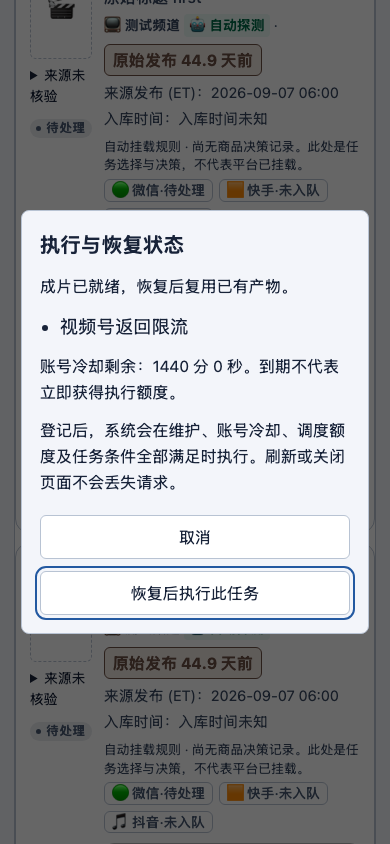
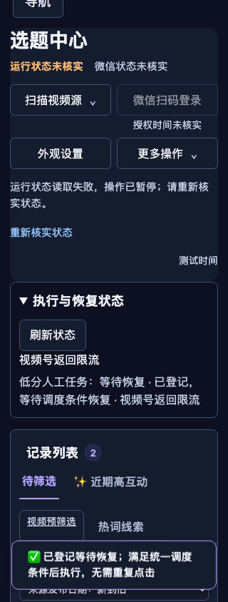

# 等待恢复实施与验收

编制：Codex；2026-10-22（北京时间）。

## 已实现

人工等待请求持久写入 execution_recovery，通过既有 ready-worker 唤起独立执行者。单视频锁内原子认领，普通自动候选排除已登记请求；未加工任务先加工再回队发布。重复请求只回读同一记录。

单次跳过冷却按钮已移除。统一状态区显示维护、账号冷却、调度额度和任务阻碍；冷却到期不承诺立即执行。账号冷却提前解除未实现。

维护期间仅允许新增意图，不允许认领业务。任务锁争用继续等待；认领后崩溃或结果未知转为需核验，不自动重做。已经结束显示实际管线状态，不把 UNDER_REVIEW 当成公开发布。

## 验收

- 当前开发快照：204 项相关测试通过。
- 从主干 bec693c 抽取的独立实现：183 项相关测试通过；不包含其他会话未提交的登录、封面、二创等改动。
- Chromium 使用真实 FastAPI API、SQLite、维护准入和文件锁；平台传输使用边界替身，没有真实发布。
- 覆盖重复登记、并发认领、等待跨重启、运行中断不重放、额度不足、维护等待、共享发布锁、分集顺序和黑名单。
- 真实浏览器验证 1366px 深色、390px 浅色/高对比、320px 深色；截图人工检查，无横向溢出，手机按钮至少 44px 高。

测试回执：video-pytest-kr2p9gg6（204 passed）；video-pytest-20788nkp（183 passed）。最终手机提示条换行和主题对比修正后，video-pytest-l8iiklui 的 6 项浏览器用例复验通过，截图已更新并人工检查。

## 生产采用尚未完成

生产主干正在被另一项受控部署更新。本次未修改生产源码、未重启业务、未取消在途任务。最新只读维护检查显示英语世界生产、恢复与扫码登录仍在执行，且存在未登记业务锁和进程，不能证明部署空闲。需在在途工作结束且维护检查通过后，合并本次独立提交并保留生产原有 dirty overlay，再通过受控部署采用。

当前结果证明本地行为与手机渲染，不证明生产已加载本次实现，也不证明平台接收或公开。

